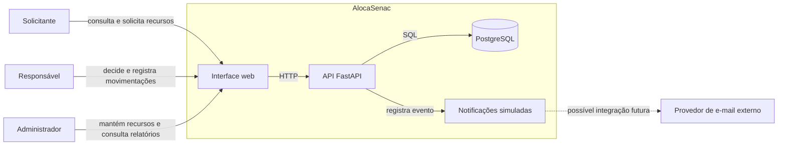

# Diagrama de contexto

O limite do sistema AlocaSenac inclui a interface web estática, a API FastAPI
e a persistência PostgreSQL. Os três perfis interagem com a interface, que
envia requisições HTTP à API; a API aplica autenticação, autorização e regras
de negócio antes de consultar ou alterar o banco. As notificações são
registradas localmente na tabela `notifications`; o PRD não integra um
provedor de e-mail externo no escopo atual. A ligação tracejada representa
somente uma possibilidade futura, não uma integração executada.

Para a separação de camadas e decisões arquiteturais, consulte
[arquitetura](./arquitetura.md) e
[ADR-05 — API e separação de camadas](./adr-05-api-e-separacao-de-camadas.md).
