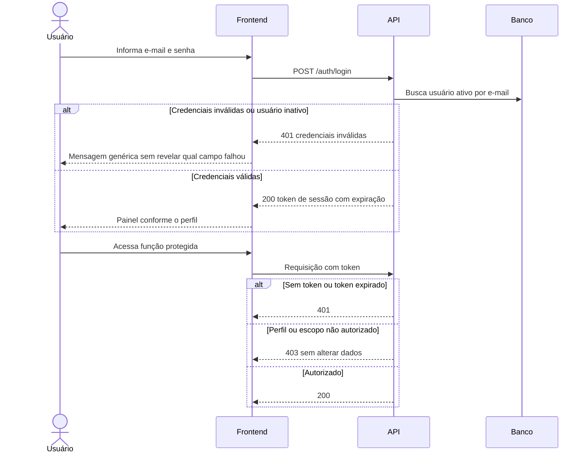
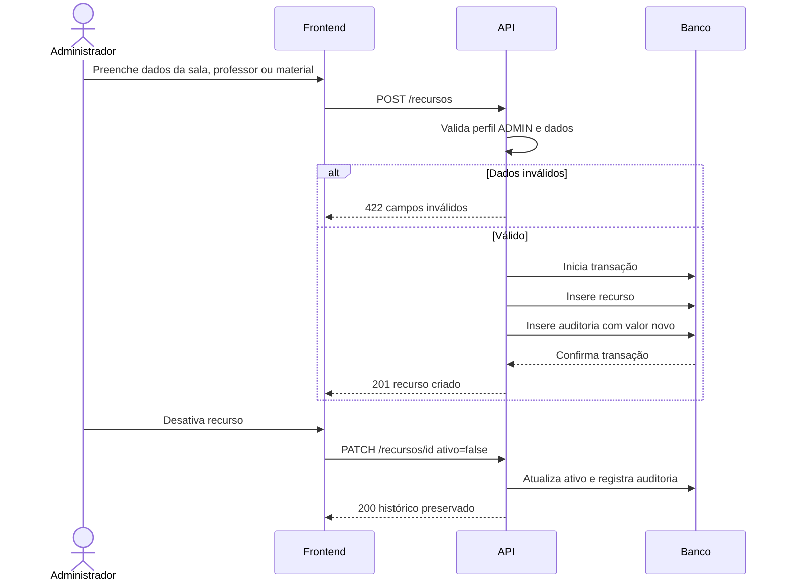
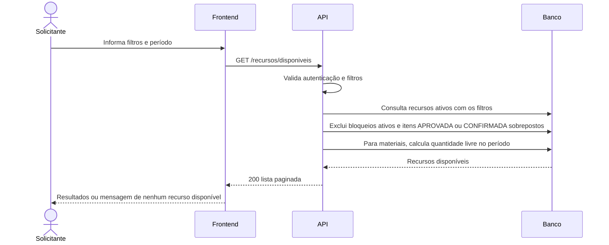
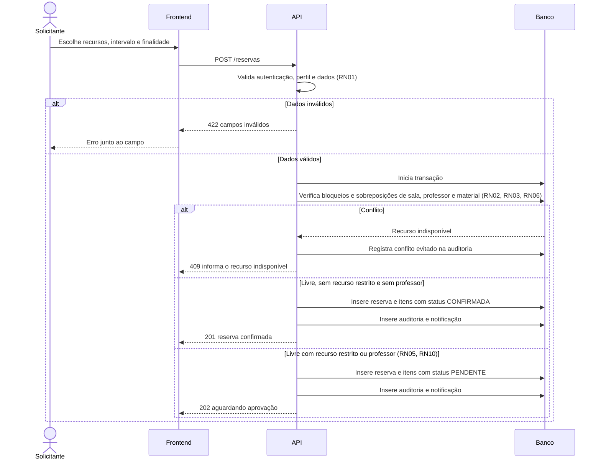
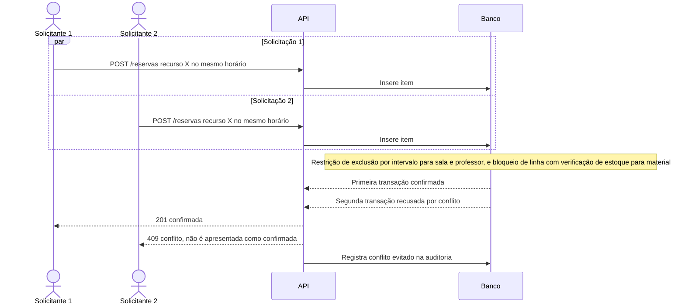
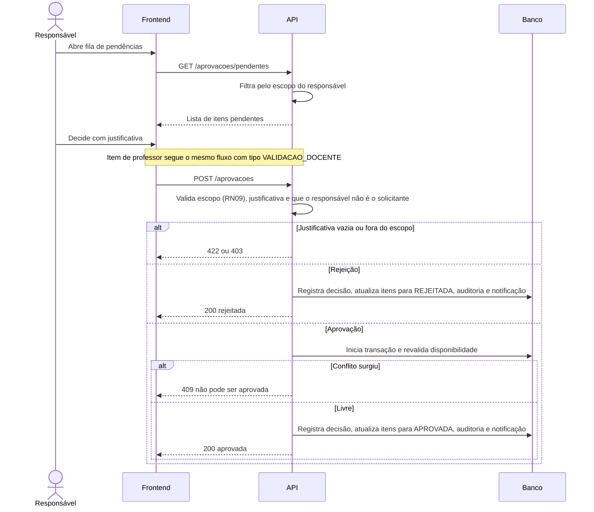
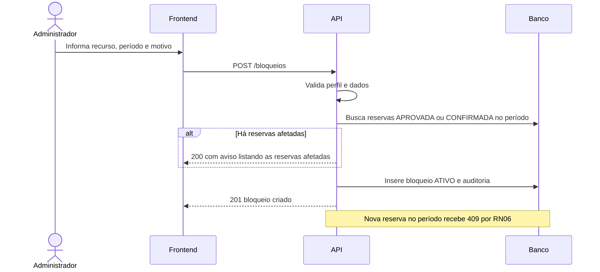
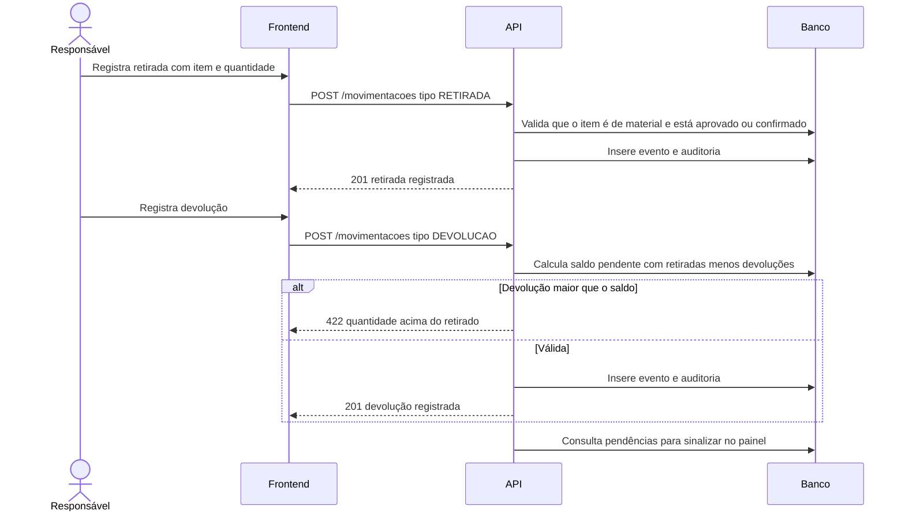
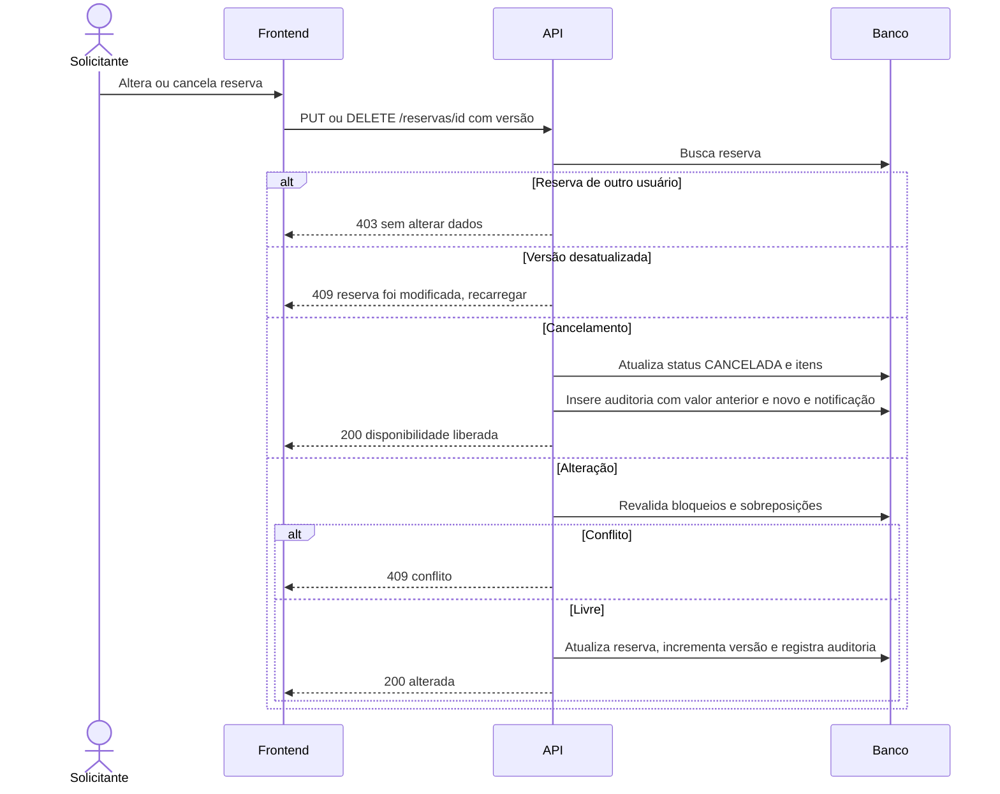
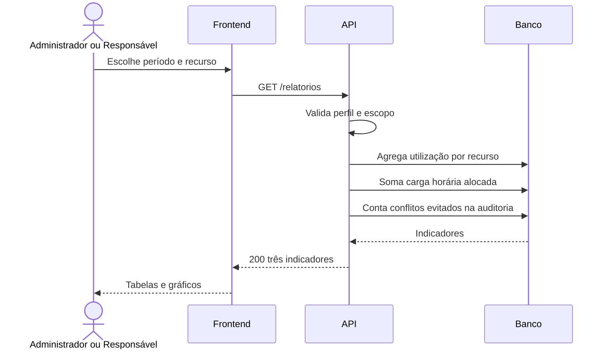

# Fluxos de sequência — Sistema acadêmico de reservas

Diagramas Mermaid (ator, Frontend, API, Banco) com caminhos de sucesso e erro. Rotas e códigos HTTP são **propostas** e devem ser confirmadas na especificação OpenAPI (FR-15).

| # | Fluxo | FR | RN | Tabelas |
|---|---|---|---|---|
| 1 | Autenticação e autorização | FR-01 | | usuarios |
| 2 | Cadastro de recursos | FR-02 | RN08 | salas, professores, materiais, auditoria |
| 3 | Pesquisa de disponibilidade | FR-03 | RN02, RN06 | reserva_itens, bloqueios |
| 4 | Criação de reserva | FR-04, FR-06 | RN01 a RN03, RN06 | reservas, reserva_itens |
| 5 | Reservas concorrentes | FR-07 | RN04 | reserva_itens |
| 6 | Aprovação de recurso restrito e validação de docente | FR-08, FR-16 | RN05, RN09, RN10 | aprovacoes, escopos_responsavel |
| 7 | Bloqueio por manutenção | FR-09 | RN06 | bloqueios |
| 8 | Retirada e devolução | FR-10 | RN07 | retiradas_devolucoes |
| 9 | Alteração e cancelamento | FR-05, FR-11, FR-12 | RN08 | reservas, auditoria, notificacoes |
| 10 | Relatórios | FR-13 | | auditoria, reserva_itens |

## 1. Autenticação e autorização (FR-01)

## 2. Cadastro de recursos (FR-02)

## 3. Pesquisa de disponibilidade (FR-03)

## 4. Criação de reserva (FR-04, FR-06)

## 5. Reservas concorrentes (FR-07, RN04)

## 6. Aprovação de recurso restrito e validação de docente (FR-08, FR-16, RN05, RN10)

## 7. Bloqueio por manutenção (FR-09, RN06)

## 8. Retirada e devolução de material (FR-10, RN07)

## 9. Alteração e cancelamento (FR-05, FR-11, FR-12)

## 10. Relatórios (FR-13)

