# Modelagem dinâmica

## FR-01 — Autenticar usuários e autorizar ações por perfil

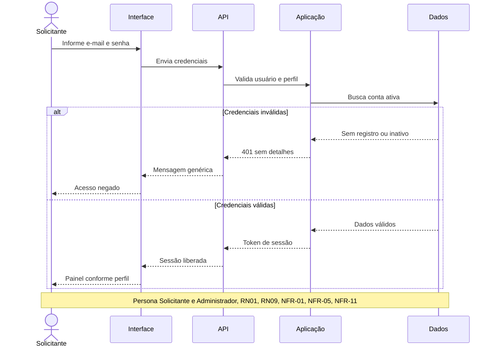

## FR-02 — Cadastrar, consultar e manter recursos

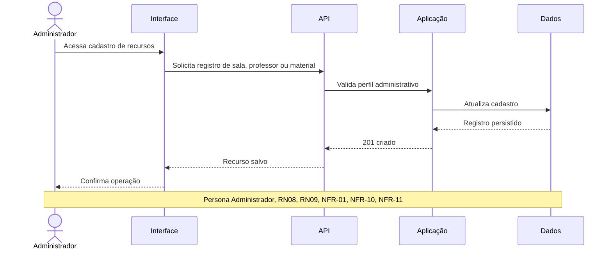

## FR-03 — Pesquisar recursos e disponibilidade

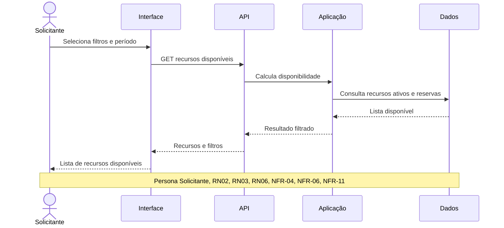

## FR-04 — Criar solicitações de reserva

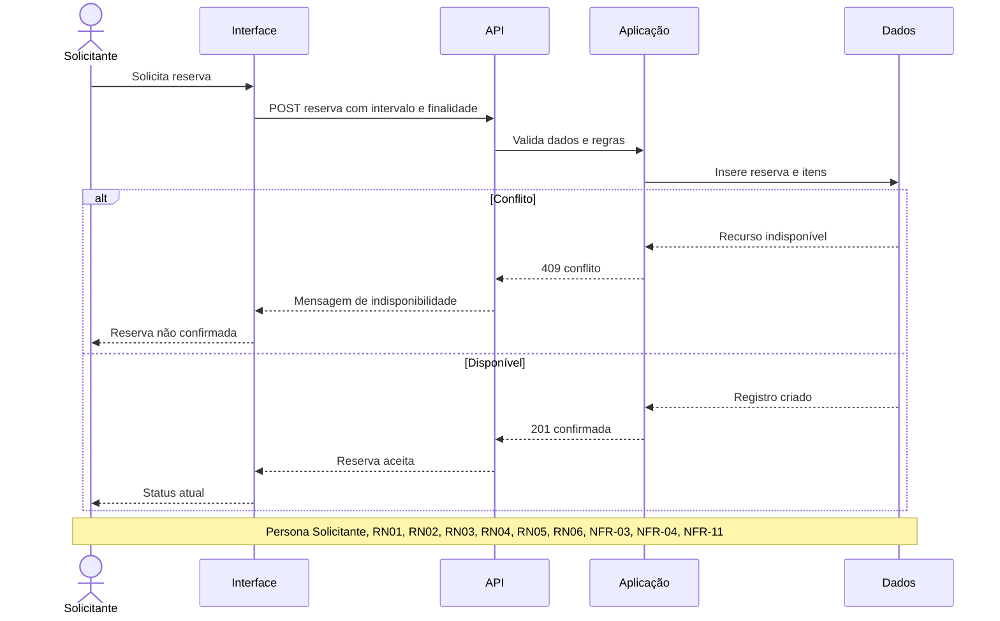

## FR-05 — Alterar e cancelar solicitações ou reservas

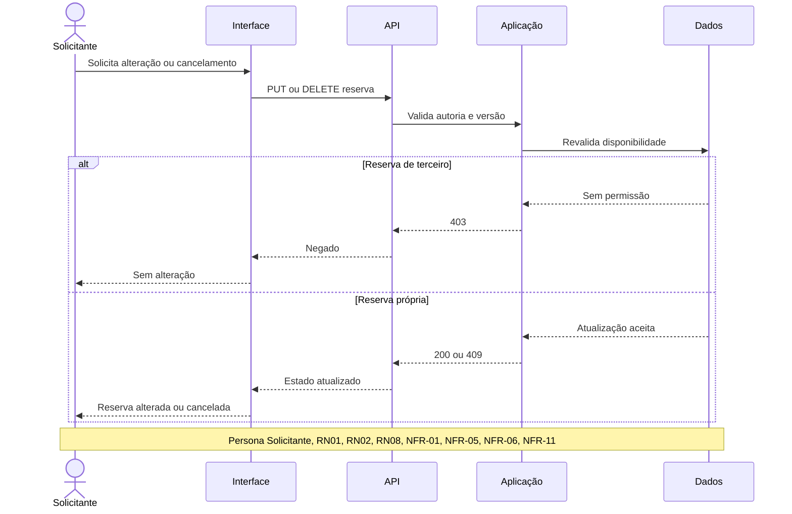

## FR-06 — Detectar conflitos de disponibilidade

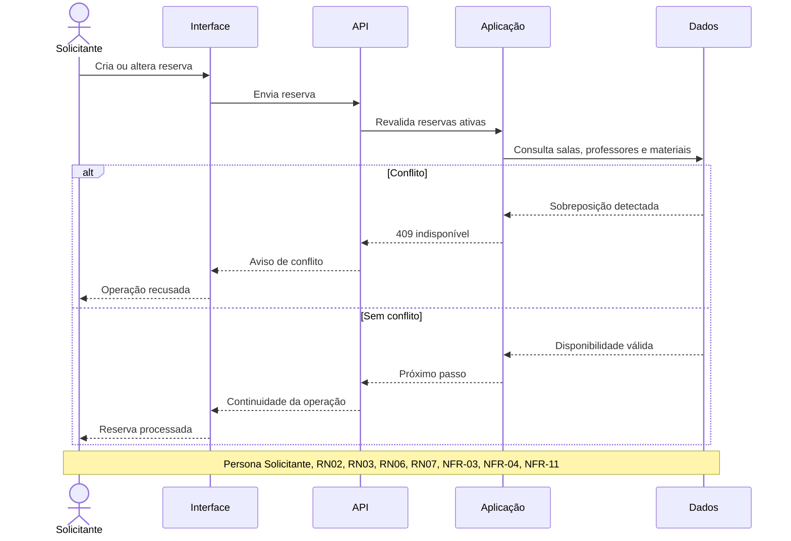

## FR-07 — Impedir dupla reserva em solicitações simultâneas

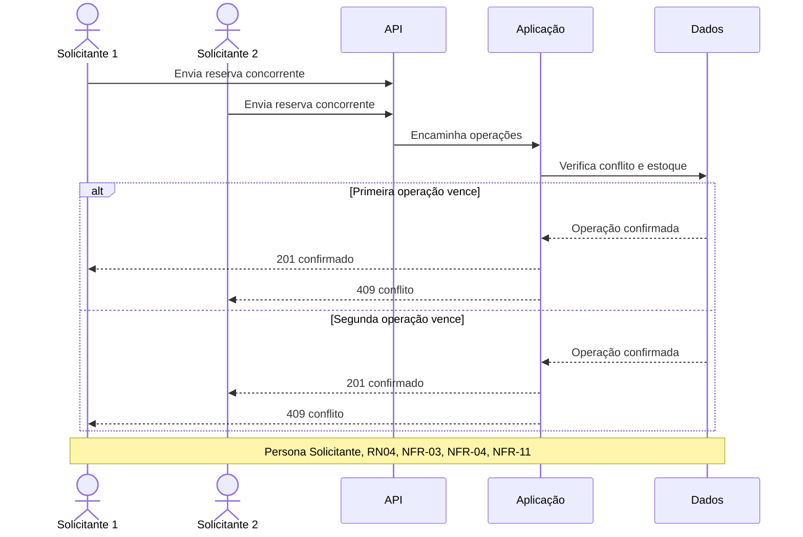

## FR-08 — Exigir aprovação para recursos restritos

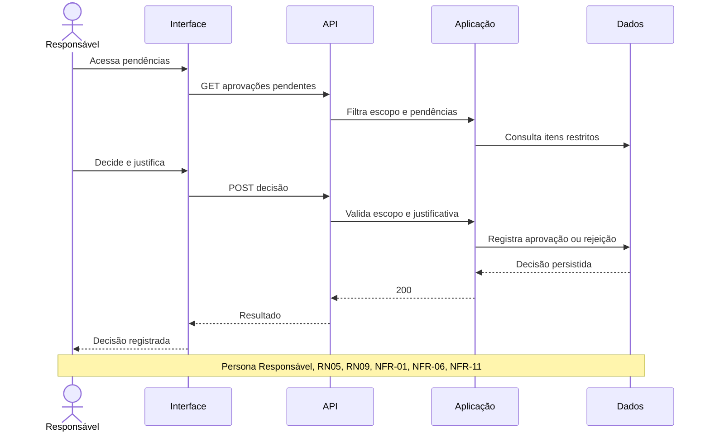

## FR-09 — Bloquear recursos em manutenção

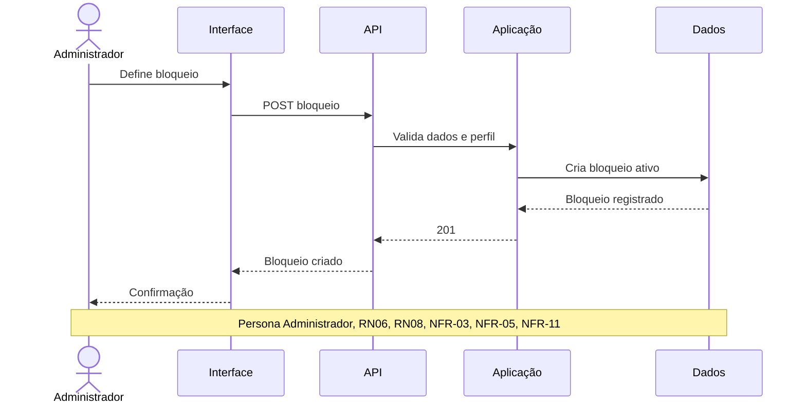

## FR-10 — Registrar retirada e devolução de materiais e equipamentos

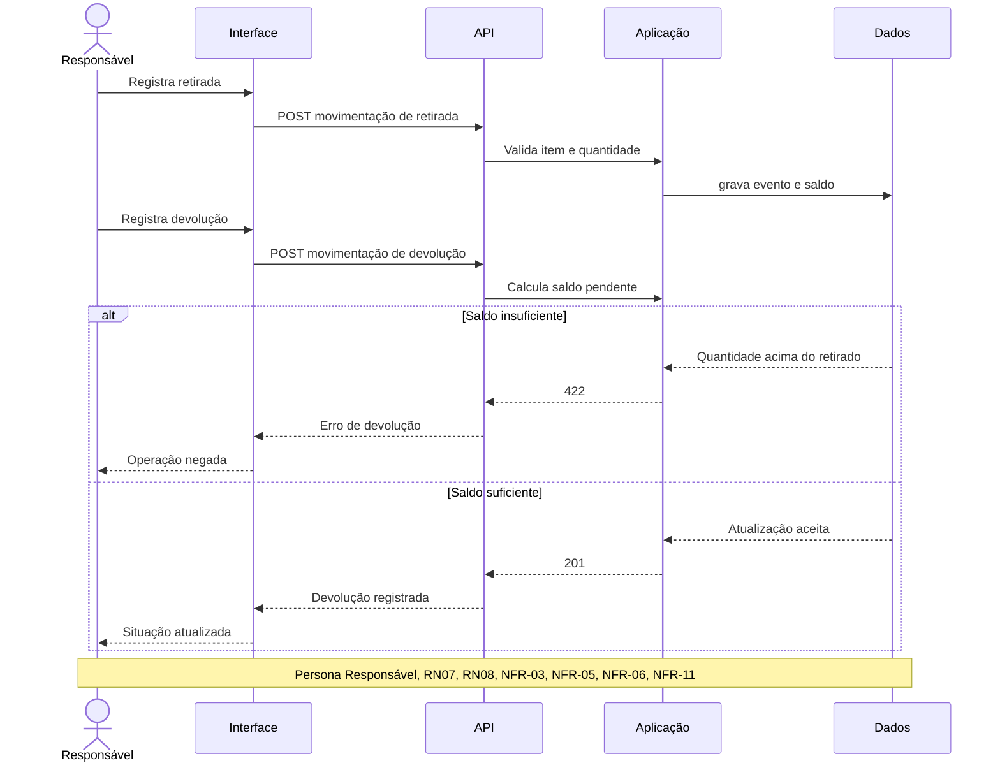

## FR-11 — Manter histórico auditável

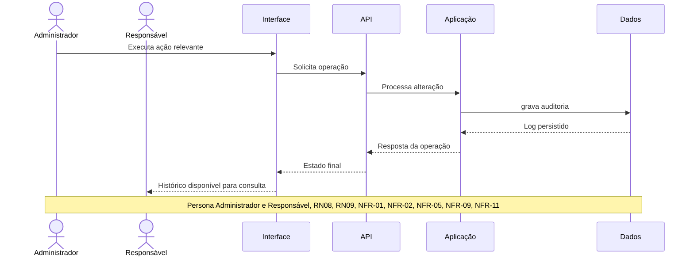

## FR-12 — Notificar mudanças de estado

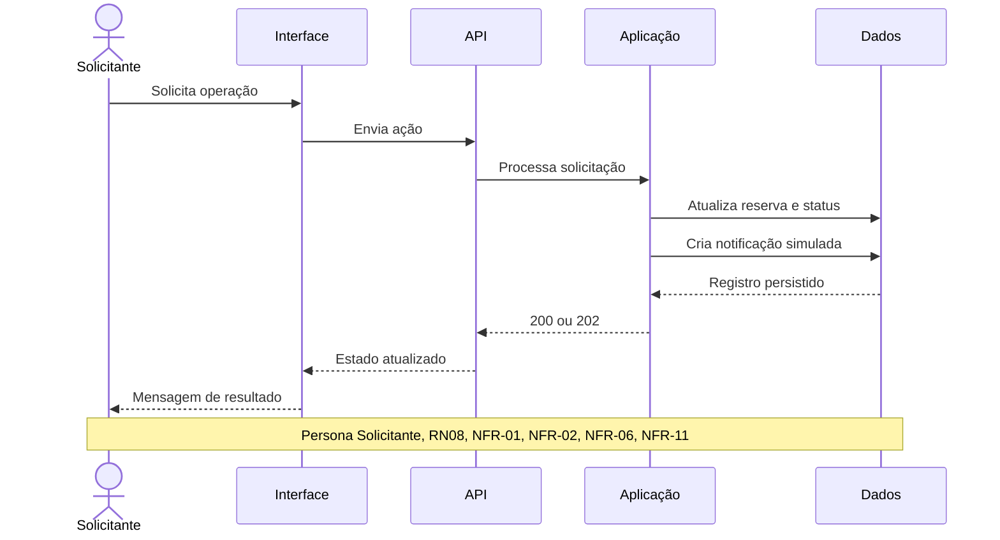

## FR-13 — Apresentar relatórios de utilização

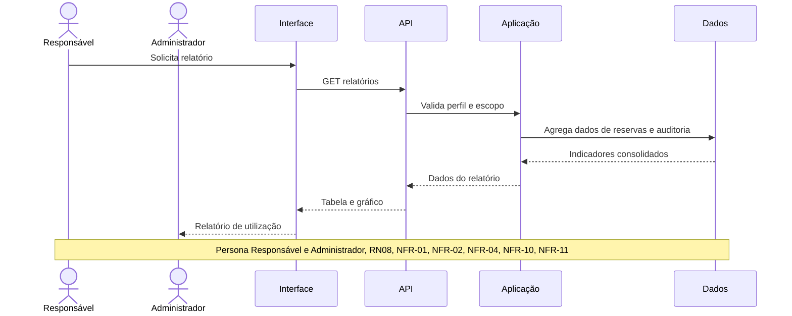

## FR-14 — Oferecer interface responsiva e mensagens compreensíveis

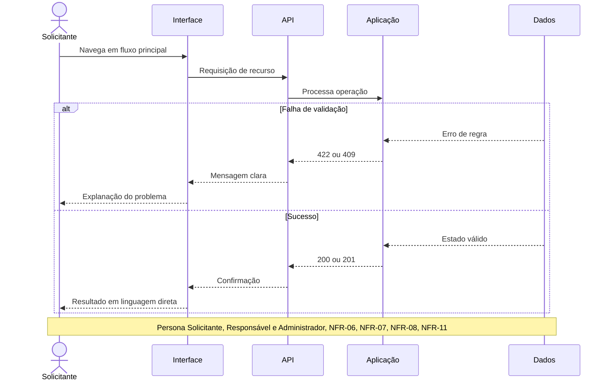

## FR-15 — Documentar API ou fluxos públicos

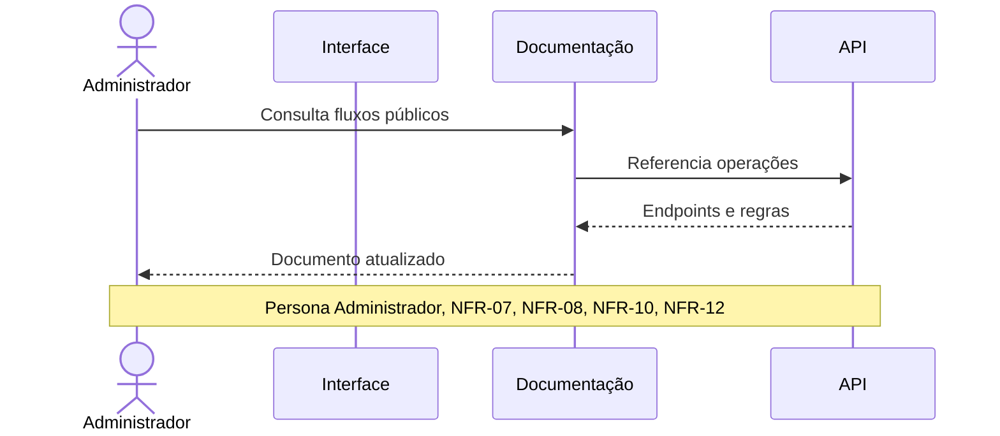

## FR-16 — Validar a alocação de docentes

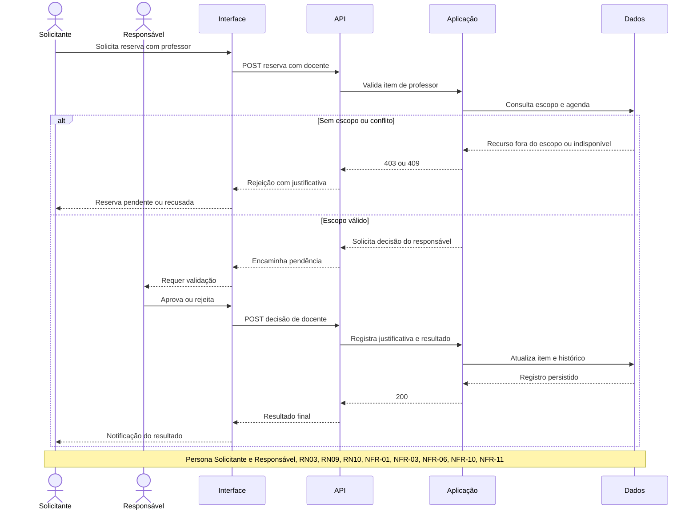
