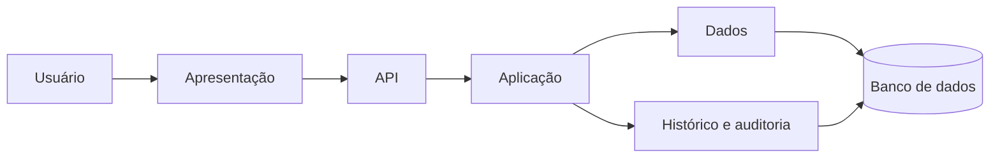
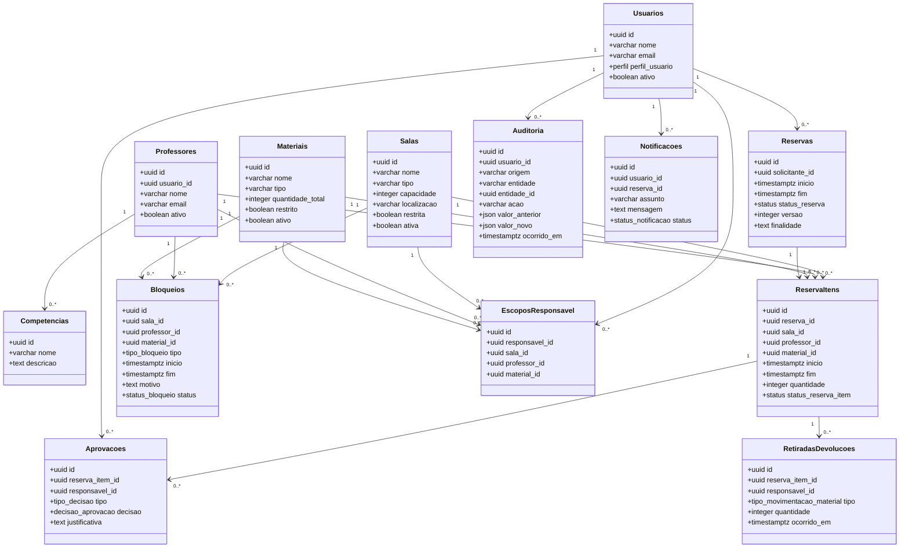

# Modelagem estática

## Diagrama de componentes agnóstico de tecnologia

## Diagrama de classes das entidades

## Mapeamento para o DBML

- `usuarios` mapeia para `usuarios`
- `salas`, `professores`, `materiais`, `competencias`, `reservas`, `reserva_itens`, `aprovacoes`, `bloqueios`, `retiradas_devolucoes`, `auditoria`, `notificacoes` e `escopos_responsavel` seguem as definições do DBML
- associações de `Ref` e `checks` preservam as regras de integridade e escopo definidas em `modelagem-dados-sistema-academico.dbml`
